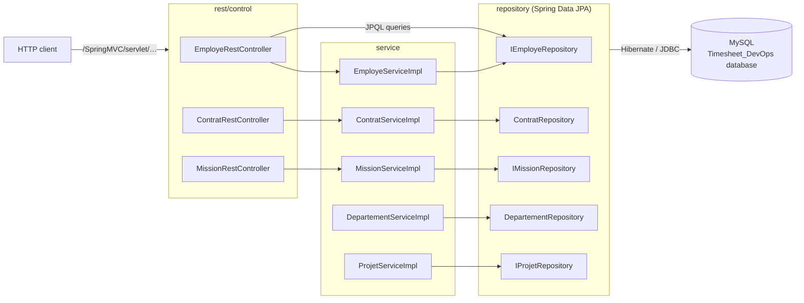
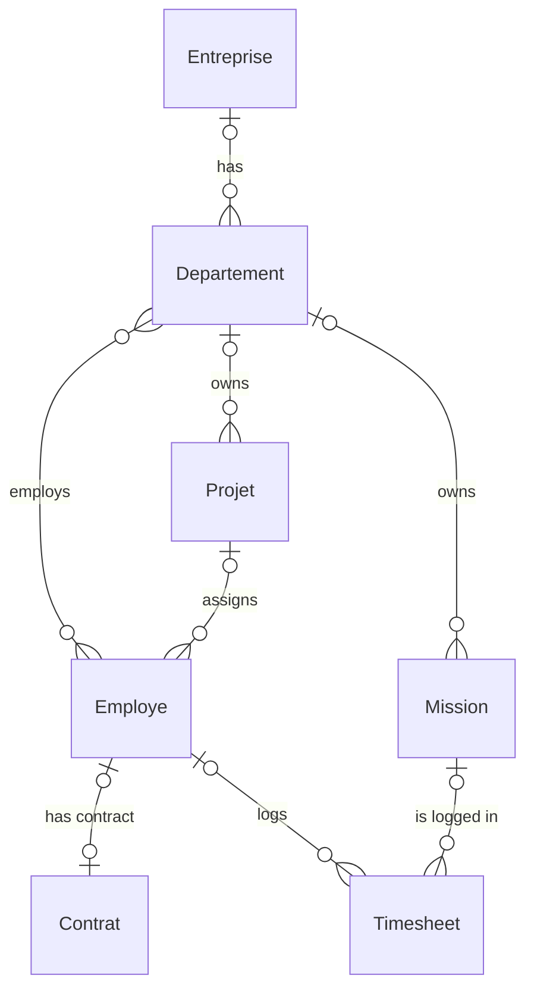
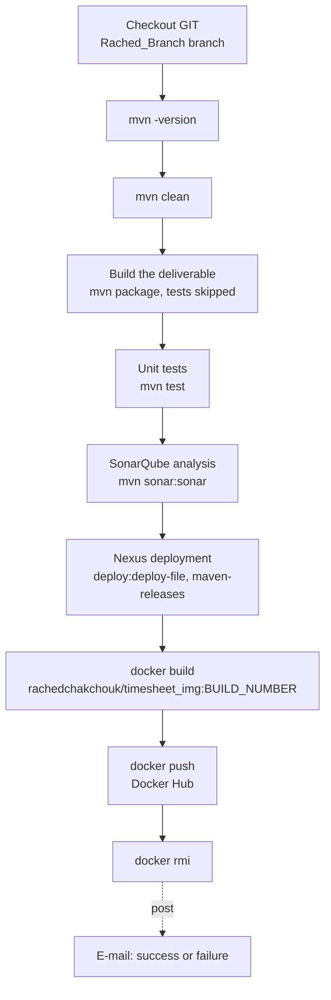

# Timesheet_DevOps — Spring Boot API and Jenkins CI/CD pipeline

[Français](README.md) · **English**

DevOps team project (ESPRIT, 2021): a Spring Boot REST API for managing employees, contracts and missions,
delivered through a Jenkins pipeline (Maven, SonarQube, Nexus, Docker Hub). This repository is a fork, in
Rached Chakchouk's account, of the team repository `TarekMESSAOUDI/Timesheet_DevOps`.

> A first iteration of the project, limited to the Employee module, lives in
> [Timeseet_DevOps](https://github.com/rachedchakchouk/Timeseet_DevOps); see
> [Relationship with Timeseet_DevOps](#relationship-with-timeseet_devops).

## Overview

- Fourteen-route REST API: employees (create, counts, names, lookup by company, lookup by email and password),
  contracts (create, delete) and missions (create, list, count, update, delete).
- JPA model: companies, departments, employees, contracts, projects, internal and external missions,
  timesheets.
- Services without a controller: departments (`DepartementServiceImpl`) and projects (`ProjetServiceImpl`); the
  external-mission controller, service and repository are empty.
- Declarative Jenkins pipeline (`Jenkinsfile`) and Docker image (`Dockerfile`).
- GitHub Actions continuous integration and Dependabot.

## Tech stack

Versions read from `pom.xml`, `Dockerfile`, `.mvn/wrapper/maven-wrapper.properties` and
`.github/workflows/ci.yml`.

| Layer | Technology | Version |
|---|---|---|
| Language | Java | 8 (`java.version` = 1.8) |
| Framework | Spring Boot (Web, Data JPA) | 2.7.18 |
| Framework | Spring Framework | 5.3.39 (pinned in the pom) |
| Embedded server | Apache Tomcat | 9.0.123 (pinned in the pom) |
| Persistence | Hibernate ORM | managed by Spring Boot |
| Database | MySQL, `com.mysql:mysql-connector-j` driver | driver 8.4.0; MySQL 8.4 in CI |
| Logging | Log4j 2 (`log4j-core`, API used by two services) and Logback (Spring Boot) | Log4j 2.25.5 (`log4j2.version`) |
| Dependencies with no related code | Apache MyFaces (JSF), OCPsoft Rewrite, `tomcat-embed-jasper`, Lombok | 2.2.15; 3.5.2.Final; managed by Spring Boot |
| Tests | `spring-boot-starter-test`, JUnit 4 (`junit`) | managed by Spring Boot |
| Coverage | JaCoCo (`jacoco-maven-plugin`) | 0.8.12 |
| Build | Maven, through the Maven Wrapper | Maven 3.8.2 |
| Container | Docker, `eclipse-temurin` base image | `8-jre-alpine` |
| CI/CD | Jenkins (declarative pipeline), SonarQube, Nexus, Docker Hub | not pinned in the repository |
| CI | GitHub Actions, Temurin JDK, MySQL service | JDK 8, `mysql:8.4` image |

## Architecture

Layered architecture: `entity` → `repository` (Spring Data JPA) → `service` → `rest/control`.



## Repository layout

```text
Timesheet_DevOps/
├── .github/
│   ├── dependabot.yml          # Maven, Docker and GitHub Actions updates
│   └── workflows/ci.yml        # CI: compilation and build against MySQL
├── .mvn/wrapper/               # Maven Wrapper (Maven 3.8.2)
├── Dockerfile                  # runtime image for the JAR
├── Jenkinsfile                 # Jenkins pipeline
├── mvnw, mvnw.cmd
├── pom.xml
└── src/main/
    ├── java/tn/esprit/spring/
    │   ├── TimesheetDevOpsApplication.java
    │   ├── entity/             # JPA entities and the Role enum
    │   ├── repository/         # Spring Data repositories (JPQL queries for employees)
    │   ├── rest/control/       # Employe, Contrat, Mission REST controllers (MissionExterne is empty)
    │   └── service/            # service interfaces and implementations
    └── resources/application.properties
```

## Prerequisites

- JDK 8 (CI uses Temurin 8). On Windows, `JAVA_HOME` must point to this JDK, otherwise `mvnw.cmd` stops.
- MySQL 8 on `localhost:3306`, with the `root` account and no password (the repository's configuration), or
  Docker.
- Git. Maven is not needed locally: the wrapper downloads Maven 3.8.2 (requires access to Maven Central).
- For the pipeline: see [Jenkins pipeline](#jenkins-pipeline-jenkinsfile).

## Local setup and run

Windows (PowerShell):

```powershell
git clone https://github.com/rachedchakchouk/Timesheet_DevOps.git
cd Timesheet_DevOps

# Optional: MySQL 8.4 as in CI (root, no password); wait until it is ready
docker run -d --name mysql-timesheet -p 3306:3306 -e MYSQL_ALLOW_EMPTY_PASSWORD=yes mysql:8.4

.\mvnw.cmd spring-boot:run
```

Linux / macOS (`mvnw` is not marked executable in the repository: run it with `sh` or `chmod +x mvnw` first):

```bash
git clone https://github.com/rachedchakchouk/Timesheet_DevOps.git
cd Timesheet_DevOps
docker run -d --name mysql-timesheet -p 3306:3306 -e MYSQL_ALLOW_EMPTY_PASSWORD=yes mysql:8.4   # optional
sh mvnw spring-boot:run
```

The application listens on port **9090**; every route is prefixed with `/SpringMVC/servlet`, for example
<http://localhost:9090/SpringMVC/servlet/getAllMissions>.

Executable JAR: `.\mvnw.cmd -B package` (or `sh mvnw -B package`) produces `target/Timesheet_DevOps-2.0.jar`, to
run with `java -jar target/Timesheet_DevOps-2.0.jar`.

### With Docker

The `Dockerfile` copies the JAR from `target/`: build it first. The image declares port 8080 (`EXPOSE 8080`),
but the application listens on 9090 (`server.port`): publish port 9090. Inside the container, `localhost` is
the container itself: give the MySQL address through `SPRING_DATASOURCE_URL`.

```powershell
.\mvnw.cmd -B package
docker build -t timesheet-devops .
docker run --rm -p 9090:9090 -e SPRING_DATASOURCE_URL="jdbc:mysql://host.docker.internal:3306/Timesheet_DevOps?createDatabaseIfNotExist=true&useSSL=false&serverTimezone=UTC" timesheet-devops
```

```bash
sh mvnw -B package
docker build -t timesheet-devops .
docker run --rm -p 9090:9090 --add-host=host.docker.internal:host-gateway \
  -e SPRING_DATASOURCE_URL='jdbc:mysql://host.docker.internal:3306/Timesheet_DevOps?createDatabaseIfNotExist=true&useSSL=false&serverTimezone=UTC' \
  timesheet-devops
```

## Configuration

All the configuration is in `src/main/resources/application.properties`; no Spring profile is defined.

| Key | Value in the repository | Purpose |
|---|---|---|
| `server.port` | `9090` | HTTP port |
| `server.servlet.context-path` | `/SpringMVC` | application path |
| `spring.mvc.servlet.path` | `/servlet` | `DispatcherServlet` path |
| `spring.datasource.url` | `jdbc:mysql://localhost:3306/Timesheet_DevOps?createDatabaseIfNotExist=true&…` | MySQL database, created if missing |
| `spring.datasource.username` | `root` | MySQL account |
| `spring.datasource.password` | empty | MySQL password |
| `spring.jpa.hibernate.ddl-auto` | `update` | schema created or updated at startup |
| `spring.jpa.show-sql` | `true` | SQL statements printed to the console |
| `spring.jpa.properties.hibernate.dialect` | `org.hibernate.dialect.MySQL5Dialect` | SQL dialect |
| `logging.file.name` | `D:/LOG` | log file (Windows path) |
| `logging.logback.rollingpolicy.max-file-size` | `100KB` | maximum size of a log file |
| `logging.level.root` | `INFO` | log level |

Any key can be overridden with an environment variable (Spring Boot convention), for example
`SPRING_DATASOURCE_USERNAME`, `SPRING_DATASOURCE_PASSWORD` or `LOGGING_FILE_NAME`: set it before starting the
application (`$env:LOGGING_FILE_NAME = "logs/timesheet.log"` in PowerShell,
`export LOGGING_FILE_NAME=logs/timesheet.log` in bash). On Linux, macOS and in the container, `D:/LOG` is a
path relative to the working directory.

## Database

- Engine: MySQL. The `Timesheet_DevOps` database is created on first startup (`createDatabaseIfNotExist=true`).
- Schema: generated by Hibernate (`ddl-auto=update`); no migration tool (Flyway, Liquibase) and no demo data.
- Tables declared with `@Table`: `T_CONTRAT`, `T_DEPARTEMENT`, `T_EMPLOYE`, `T_ENTREPRISE`, `T_MISSION` (internal
  and external missions, single-table inheritance) and `T_TIMESHEET`; the `Projet` entity has no `@Table`
  annotation. Hibernate creates them in lower case (`t_employe`…), with a join table for the `Departement` –
  `Employe` relationship.
- The `MySQL5Dialect` dialect creates MyISAM tables: MySQL does not enforce foreign keys on them and they have
  no transaction support.



`MissionExterne` extends `Mission` (`emailFacturation` and `tauxJournalierMoyen` fields). The `Role` enum (an
employee's role) is one of `CHEF_DEPARTEMENT`, `INGENIEUR`, `TECHNICIEN`, `STUDENT` or `ADMINISTRATEUR`.

## API

Base URL: `http://localhost:9090/SpringMVC/servlet`. No route is protected.

| Method | Path | Input | Response |
|---|---|---|---|
| POST | `/ajouter-employe` | `Employe` JSON body | saved employee |
| GET | `/count-employe` | — | number of employees |
| GET | `/count-employe-jpql` | — | number of employees (JPQL query) |
| GET | `/get-employeprenom-by-id/{idemploye}` | ID | the `nomEmploye` field, or the text `Employe dose not exist` |
| GET | `/get-all-nameemploye` | — | list of last names (`nomEmploye`) |
| GET | `/get-all-employe-by-entreprise` | `Entreprise` JSON body (GET request with a body) | employees of the company's departments |
| GET | `/get-employe-by-email-password/{email}/{password}` | email and password in the URL | matching employee |
| POST | `/ajouterContrat` | `Contrat` JSON body | saved contract |
| DELETE | `/deleteContratById/{idcontrat}` | ID | — |
| POST | `/ajouterMission` | `Mission` JSON body | saved mission |
| GET | `/getAllMissions` | — | list of missions |
| GET | `/count-Missions` | — | number of missions |
| PUT | `/update-Mission` | `Mission` JSON body with `idMission` | mission with its name and description updated |
| DELETE | `/deleteMission/{id}` | ID | — |

Example (JSON keys follow the entities' accessors):

```bash
curl -X POST http://localhost:9090/SpringMVC/servlet/ajouterMission \
  -H "Content-Type: application/json" \
  -d '{"nameMission":"Audit","descriptionMission":"Mission de test"}'
curl http://localhost:9090/SpringMVC/servlet/getAllMissions
```

```powershell
Invoke-RestMethod -Method Post -Uri http://localhost:9090/SpringMVC/servlet/ajouterMission -ContentType "application/json" -Body '{"nameMission":"Audit","descriptionMission":"Mission de test"}'
Invoke-RestMethod http://localhost:9090/SpringMVC/servlet/getAllMissions
```

## Tests

The `master` branch has no tests: the test classes were deleted on 6 November 2021 (commit `bfc3bbd`). The
`Rached_Branch` branch, the one the Jenkins pipeline builds, still has `TimesheetDevOpsApplicationTests` and
`ProjetTest`.

In CI, `mvn -B verify` therefore runs no test ("No tests to run") and the JaCoCo report is skipped for lack of
data: the CI checks compilation and the JAR build, not application startup. The workflow excludes no test.
When tests exist, JaCoCo instruments their run (`prepare-agent` in the `test-compile` phase) and writes its
report in the `verify` phase (`target/site/jacoco/`). Local command: `.\mvnw.cmd -B verify` (PowerShell) or
`sh mvnw -B verify`.

## Build, CI and deployment

### GitHub Actions

The `.github/workflows/ci.yml` workflow ("CI") runs on every push to `master` or `main` and on every pull
request (including Dependabot's); a new run cancels the previous one on the same ref. The "Back (Maven)" job
runs on `ubuntu-latest` (25 minutes at most) with a `mysql:8.4` service (`root` account, no password) and
Temurin JDK 8 (Maven cache), runs `mvn -B verify`, then, on failure, reports the errors as annotations
("Résumé des erreurs" step). No artifact is published.

`.github/dependabot.yml` opens grouped updates for Maven, the Docker base image and GitHub Actions every Monday
at 06:00 (Tunis time); major upgrades of Spring Boot and `eclipse-temurin` (Java 8) are excluded.

### Jenkins pipeline (`Jenkinsfile`)

Declarative pipeline written for a Windows agent (`bat` commands). It clones the fork's `Rached_Branch` branch,
not `master`.



| Stage | Command |
|---|---|
| Deployment | `mvn clean package -Dmaven.test.skip=true … deploy:deploy-file`: `target/Timesheet_DevOps-2.0.jar` published as version `2.0` to `http://localhost:8081/repository/maven-releases/` (`-DrepositoryId=deploymentRepo`) |
| Image | `docker.build` of `rachedchakchouk/timesheet_img:<build number>`, pushed to Docker Hub with the `dockerHub` Jenkins credential, then removed locally |
| Notification | `emailext` after the pipeline, on success or failure |

What the pipeline expects on the Jenkins machine, based on the steps it uses:

- a Windows agent with Maven and Docker on the `PATH`;
- the Git, Docker Pipeline (`docker.build`, `docker.withRegistry`) and Email Extension (`emailext`) plugins;
- a `dockerHub` Jenkins credential (Docker Hub account);
- a SonarQube server reachable by `mvn sonar:sonar` (no URL in the repository: the machine's Maven settings, or
  the plugin default, `http://localhost:9000`);
- a Nexus on `http://localhost:8081` with the `maven-releases` repository, and the credentials of the
  `deploymentRepo` server in Maven's `settings.xml`.

### Docker image (`Dockerfile`)

`eclipse-temurin:8-jre-alpine` image, `/app` working directory, JAR copied from `target/*.jar` as
`timesheet_devops.jar` and started with `java -jar`; declared port: 8080 (see [With Docker](#with-docker)).

## Security

- No Spring Security: every route is public; no CORS rule is defined.
- Employee passwords are stored in plain text and returned in the employee JSON; the
  `/get-employe-by-email-password/{email}/{password}` route sends the password in the URL.
- No secret is committed: MySQL is used with `root` and no password (locally and in CI); the pipeline only
  refers to Jenkins (`dockerHub`) and Maven (`deploymentRepo`) credentials stored outside the repository.

## Relationship with Timeseet_DevOps

Both repositories belong to the same team project, but they share no commit.

| | [Timeseet_DevOps](https://github.com/rachedchakchouk/Timeseet_DevOps) | Timesheet_DevOps (this repository) |
|---|---|---|
| Nature | standalone repository, created on 10 October 2021 | fork of `TarekMESSAOUDI/Timesheet_DevOps` |
| Original code | three commits from 9 October 2021 | team history from October to November 2021 |
| Maven version | `1.0` | `2.0` |
| Business code | Employee module: one repository, one service, one REST controller, one JSF bean | Employee, Contract and Mission modules exposed over REST; Department and Project services |
| Entities | `Contrat`, `Departement`, `Employe`, `Entreprise`, `Mission`, `MissionExterne`, `Timesheet`, `User` | the same without `User`, plus `Projet` |
| Tests | context startup and `EmployeServiceImplTest` | none on `master` (removed on 6 November 2021) |
| DevOps tooling | GitHub Actions (added in 2026) | Jenkinsfile (SonarQube, Nexus, Docker Hub), Dockerfile, JaCoCo, GitHub Actions |

## Team and author

Team project of six students (ESPRIT, 2021). Each member worked on their own branch (`Tarek_Branch`,
`Amine_Branch`, `Ghassen_Branch`, `Meissa_Branch`, `Moneim_Branch`, `Rached_Branch`), merged into `master` through
pull requests; these branches are kept in the fork. Rached Chakchouk notably added the Project module (entity,
repository, service) and adapted the Jenkins pipeline to his branch (clone of `Rached_Branch`, publication of
the `rachedchakchouk/timesheet_img` image).

**Rached Chakchouk** — Full Stack Software Engineer (Java / Spring Boot / Angular) ·
[LinkedIn](https://www.linkedin.com/in/rached-chakchouk) · [Portfolio](https://rached-chakchouk.netlify.app)
