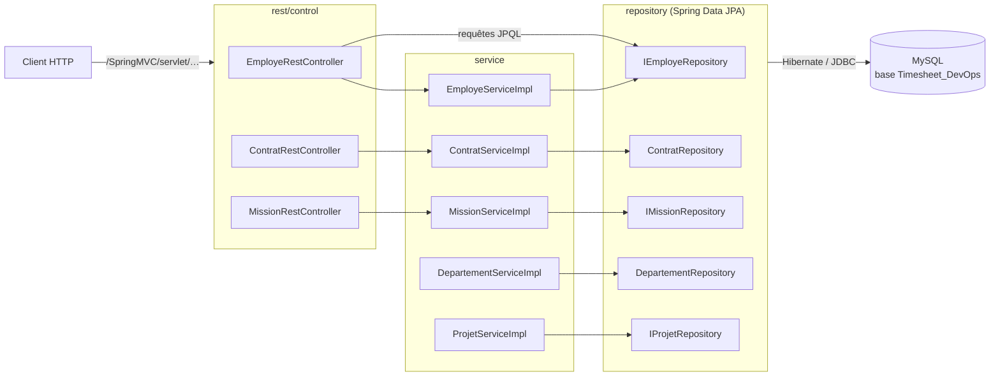
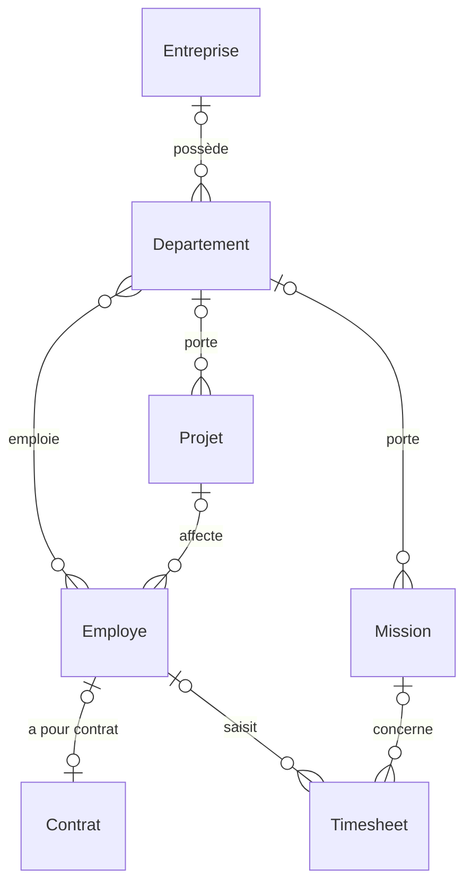
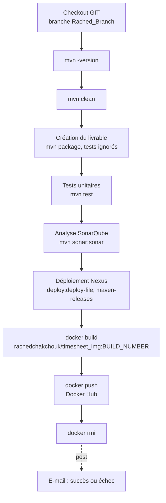

# Timesheet_DevOps — API Spring Boot et chaîne CI/CD Jenkins

**Français** · [English](README.en.md)

Projet d'équipe DevOps (ESPRIT, 2021) : une API REST Spring Boot de gestion des employés, des contrats et des
missions, livrée par un pipeline Jenkins (Maven, SonarQube, Nexus, Docker Hub). Ce dépôt est un fork, sur le
compte de Rached Chakchouk, du dépôt d'équipe `TarekMESSAOUDI/Timesheet_DevOps`.

> Une première itération du projet, limitée au module Employé, se trouve dans
> [Timeseet_DevOps](https://github.com/rachedchakchouk/Timeseet_DevOps) ; voir
> [Lien avec Timeseet_DevOps](#lien-avec-timeseet_devops).

## Aperçu

- API REST de quatorze routes : employés (création, comptages, noms, recherche par entreprise, recherche par
  e-mail et mot de passe), contrats (création, suppression) et missions (création, liste, comptage,
  modification, suppression).
- Modèle JPA : entreprises, départements, employés, contrats, projets, missions internes et externes, feuilles
  de temps.
- Services sans contrôleur : départements (`DepartementServiceImpl`) et projets (`ProjetServiceImpl`) ; le
  contrôleur, le service et le dépôt des missions externes sont vides.
- Pipeline Jenkins déclaratif (`Jenkinsfile`) et image Docker (`Dockerfile`).
- Intégration continue GitHub Actions et Dependabot.

## Stack technique

Versions lues dans `pom.xml`, `Dockerfile`, `.mvn/wrapper/maven-wrapper.properties` et
`.github/workflows/ci.yml`.

| Couche | Technologie | Version |
|---|---|---|
| Langage | Java | 8 (`java.version` = 1.8) |
| Framework | Spring Boot (Web, Data JPA) | 2.7.18 |
| Framework | Spring Framework | 5.3.39 (fixée dans le pom) |
| Serveur embarqué | Apache Tomcat | 9.0.123 (fixée dans le pom) |
| Persistance | Hibernate ORM | gérée par Spring Boot |
| Base de données | MySQL, pilote `com.mysql:mysql-connector-j` | pilote 8.4.0 ; MySQL 8.4 en CI |
| Journalisation | Log4j 2 (`log4j-core`, API utilisée par deux services) et Logback (Spring Boot) | Log4j 2.25.5 (`log4j2.version`) |
| Dépendances sans code associé | Apache MyFaces (JSF), OCPsoft Rewrite, `tomcat-embed-jasper`, Lombok | 2.2.15 ; 3.5.2.Final ; gérées par Spring Boot |
| Tests | `spring-boot-starter-test`, JUnit 4 (`junit`) | gérées par Spring Boot |
| Couverture | JaCoCo (`jacoco-maven-plugin`) | 0.8.12 |
| Build | Maven, via le Maven Wrapper | Maven 3.8.2 |
| Conteneur | Docker, image de base `eclipse-temurin` | `8-jre-alpine` |
| CI/CD | Jenkins (pipeline déclaratif), SonarQube, Nexus, Docker Hub | non fixées dans le dépôt |
| CI | GitHub Actions, JDK Temurin, service MySQL | JDK 8, image `mysql:8.4` |

## Architecture

Architecture en couches : `entity` → `repository` (Spring Data JPA) → `service` → `rest/control`.



## Structure du dépôt

```text
Timesheet_DevOps/
├── .github/
│   ├── dependabot.yml          # mises à jour Maven, Docker et GitHub Actions
│   └── workflows/ci.yml        # CI : compilation et build avec MySQL
├── .mvn/wrapper/               # Maven Wrapper (Maven 3.8.2)
├── Dockerfile                  # image d'exécution du JAR
├── Jenkinsfile                 # pipeline Jenkins
├── mvnw, mvnw.cmd
├── pom.xml
└── src/main/
    ├── java/tn/esprit/spring/
    │   ├── TimesheetDevOpsApplication.java
    │   ├── entity/             # entités JPA et énumération Role
    │   ├── repository/         # dépôts Spring Data (requêtes JPQL pour les employés)
    │   ├── rest/control/       # contrôleurs REST Employe, Contrat, Mission (MissionExterne vide)
    │   └── service/            # interfaces et implémentations des services
    └── resources/application.properties
```

## Prérequis

- JDK 8 (la CI utilise Temurin 8). Sous Windows, `JAVA_HOME` doit pointer vers ce JDK : `mvnw.cmd` s'arrête
  sinon.
- MySQL 8 sur `localhost:3306`, avec le compte `root` sans mot de passe (configuration du dépôt), ou Docker.
- Git. Maven n'est pas nécessaire en local : le wrapper télécharge Maven 3.8.2 (accès à Maven Central requis).
- Pour le pipeline : voir [Pipeline Jenkins](#pipeline-jenkins-jenkinsfile).

## Installation et lancement en local

Windows (PowerShell) :

```powershell
git clone https://github.com/rachedchakchouk/Timesheet_DevOps.git
cd Timesheet_DevOps

# Facultatif : MySQL 8.4 comme en CI (root sans mot de passe) ; attendez qu'il soit prêt
docker run -d --name mysql-timesheet -p 3306:3306 -e MYSQL_ALLOW_EMPTY_PASSWORD=yes mysql:8.4

.\mvnw.cmd spring-boot:run
```

Linux / macOS (`mvnw` n'est pas marqué exécutable dans le dépôt : lancez-le avec `sh` ou faites `chmod +x mvnw`) :

```bash
git clone https://github.com/rachedchakchouk/Timesheet_DevOps.git
cd Timesheet_DevOps
docker run -d --name mysql-timesheet -p 3306:3306 -e MYSQL_ALLOW_EMPTY_PASSWORD=yes mysql:8.4   # facultatif
sh mvnw spring-boot:run
```

L'application écoute sur le port **9090** ; toutes les routes sont préfixées par `/SpringMVC/servlet`, par
exemple <http://localhost:9090/SpringMVC/servlet/getAllMissions>.

JAR exécutable : `.\mvnw.cmd -B package` (ou `sh mvnw -B package`) produit `target/Timesheet_DevOps-2.0.jar`,
à lancer avec `java -jar target/Timesheet_DevOps-2.0.jar`.

### Avec Docker

Le `Dockerfile` copie le JAR de `target/` : construisez-le d'abord. L'image déclare le port 8080
(`EXPOSE 8080`), mais l'application écoute sur 9090 (`server.port`) : publiez le port 9090. Dans le conteneur,
`localhost` désigne le conteneur lui-même : indiquez l'adresse de MySQL par `SPRING_DATASOURCE_URL`.

```powershell
.\mvnw.cmd -B package
docker build -t timesheet-devops .
docker run --rm -p 9090:9090 -e SPRING_DATASOURCE_URL="jdbc:mysql://host.docker.internal:3306/Timesheet_DevOps?createDatabaseIfNotExist=true&useSSL=false&serverTimezone=UTC" timesheet-devops
```

```bash
sh mvnw -B package
docker build -t timesheet-devops .
docker run --rm -p 9090:9090 --add-host=host.docker.internal:host-gateway \
  -e SPRING_DATASOURCE_URL='jdbc:mysql://host.docker.internal:3306/Timesheet_DevOps?createDatabaseIfNotExist=true&useSSL=false&serverTimezone=UTC' \
  timesheet-devops
```

## Configuration

Toute la configuration se trouve dans `src/main/resources/application.properties` ; aucun profil Spring n'est
défini.

| Clé | Valeur dans le dépôt | Rôle |
|---|---|---|
| `server.port` | `9090` | port HTTP |
| `server.servlet.context-path` | `/SpringMVC` | chemin de l'application |
| `spring.mvc.servlet.path` | `/servlet` | chemin du `DispatcherServlet` |
| `spring.datasource.url` | `jdbc:mysql://localhost:3306/Timesheet_DevOps?createDatabaseIfNotExist=true&…` | base MySQL, créée si elle n'existe pas |
| `spring.datasource.username` | `root` | compte MySQL |
| `spring.datasource.password` | vide | mot de passe MySQL |
| `spring.jpa.hibernate.ddl-auto` | `update` | schéma créé ou mis à jour au démarrage |
| `spring.jpa.show-sql` | `true` | requêtes SQL affichées dans la console |
| `spring.jpa.properties.hibernate.dialect` | `org.hibernate.dialect.MySQL5Dialect` | dialecte SQL |
| `logging.file.name` | `D:/LOG` | fichier de journal (chemin Windows) |
| `logging.logback.rollingpolicy.max-file-size` | `100KB` | taille maximale d'un fichier de journal |
| `logging.level.root` | `INFO` | niveau de journalisation |

Toute clé peut être remplacée par une variable d'environnement (convention Spring Boot), par exemple
`SPRING_DATASOURCE_USERNAME`, `SPRING_DATASOURCE_PASSWORD` ou `LOGGING_FILE_NAME` : définissez-la avant le
lancement (`$env:LOGGING_FILE_NAME = "logs/timesheet.log"` sous PowerShell,
`export LOGGING_FILE_NAME=logs/timesheet.log` sous bash). Sous Linux, macOS et dans le conteneur, `D:/LOG` est
un chemin relatif au répertoire de lancement.

## Base de données

- Moteur : MySQL. La base `Timesheet_DevOps` est créée au premier démarrage (`createDatabaseIfNotExist=true`).
- Schéma : généré par Hibernate (`ddl-auto=update`) ; aucun outil de migration (Flyway, Liquibase) et aucune
  donnée de démonstration.
- Tables déclarées par `@Table` : `T_CONTRAT`, `T_DEPARTEMENT`, `T_EMPLOYE`, `T_ENTREPRISE`, `T_MISSION` (missions
  internes et externes, héritage en table unique) et `T_TIMESHEET` ; l'entité `Projet` n'a pas d'annotation
  `@Table`. Hibernate les crée en minuscules (`t_employe`…), avec une table de jointure pour la relation
  `Departement` – `Employe`.
- Le dialecte `MySQL5Dialect` crée des tables MyISAM : MySQL n'y applique pas les clés étrangères et n'y gère
  pas les transactions.



`MissionExterne` hérite de `Mission` (champs `emailFacturation`, `tauxJournalierMoyen`). L'énumération `Role`
(rôle d'un employé) vaut `CHEF_DEPARTEMENT`, `INGENIEUR`, `TECHNICIEN`, `STUDENT` ou `ADMINISTRATEUR`.

## API

URL de base : `http://localhost:9090/SpringMVC/servlet`. Aucune route n'est protégée.

| Méthode | Chemin | Entrée | Réponse |
|---|---|---|---|
| POST | `/ajouter-employe` | corps JSON `Employe` | employé enregistré |
| GET | `/count-employe` | — | nombre d'employés |
| GET | `/count-employe-jpql` | — | nombre d'employés (requête JPQL) |
| GET | `/get-employeprenom-by-id/{idemploye}` | identifiant | champ `nomEmploye`, ou le texte `Employe dose not exist` |
| GET | `/get-all-nameemploye` | — | liste des noms (`nomEmploye`) |
| GET | `/get-all-employe-by-entreprise` | corps JSON `Entreprise` (requête GET avec corps) | employés des départements de l'entreprise |
| GET | `/get-employe-by-email-password/{email}/{password}` | e-mail et mot de passe dans l'URL | employé correspondant |
| POST | `/ajouterContrat` | corps JSON `Contrat` | contrat enregistré |
| DELETE | `/deleteContratById/{idcontrat}` | identifiant | — |
| POST | `/ajouterMission` | corps JSON `Mission` | mission enregistrée |
| GET | `/getAllMissions` | — | liste des missions |
| GET | `/count-Missions` | — | nombre de missions |
| PUT | `/update-Mission` | corps JSON `Mission` avec `idMission` | mission dont le nom et la description ont été mis à jour |
| DELETE | `/deleteMission/{id}` | identifiant | — |

Exemple (les clés JSON suivent les accesseurs des entités) :

```bash
curl -X POST http://localhost:9090/SpringMVC/servlet/ajouterMission \
  -H "Content-Type: application/json" \
  -d '{"nameMission":"Audit","descriptionMission":"Mission de test"}'
curl http://localhost:9090/SpringMVC/servlet/getAllMissions
```

```powershell
Invoke-RestMethod -Method Post -Uri http://localhost:9090/SpringMVC/servlet/ajouterMission -ContentType "application/json" -Body '{"nameMission":"Audit","descriptionMission":"Mission de test"}'
Invoke-RestMethod http://localhost:9090/SpringMVC/servlet/getAllMissions
```

## Tests

La branche `master` ne contient aucun test : les classes de test ont été supprimées le 6 novembre 2021
(commit `bfc3bbd`). La branche `Rached_Branch`, celle que construit le pipeline Jenkins, conserve
`TimesheetDevOpsApplicationTests` et `ProjetTest`.

En CI, `mvn -B verify` ne lance donc aucun test (« No tests to run ») et le rapport JaCoCo est sauté faute de
données : la CI vérifie la compilation et la construction du JAR, pas le démarrage de l'application. Aucun test
n'est exclu par le workflow. Lorsque des tests existent, JaCoCo instrumente leur exécution (`prepare-agent` à
la phase `test-compile`) et écrit son rapport à la phase `verify` (`target/site/jacoco/`). Commande locale :
`.\mvnw.cmd -B verify` (PowerShell) ou `sh mvnw -B verify`.

## Build, CI et déploiement

### GitHub Actions

Le workflow `.github/workflows/ci.yml` (« CI ») se déclenche à chaque push sur `master` ou `main` et à chaque
pull request (y compris celles de Dependabot) ; un nouveau run annule le précédent sur la même référence. Le job
« Back (Maven) » tourne sur `ubuntu-latest` (25 minutes au plus) avec un service `mysql:8.4` (compte `root` sans
mot de passe) et le JDK Temurin 8 (cache Maven), lance `mvn -B verify`, puis, en cas d'échec, remonte les
erreurs sous forme d'annotations (« Résumé des erreurs »). Aucun artefact n'est publié.

`.github/dependabot.yml` propose chaque lundi à 06:00 (heure de Tunis) des mises à jour groupées pour Maven,
l'image Docker de base et les actions GitHub ; les montées majeures de Spring Boot et d'`eclipse-temurin`
(Java 8) sont exclues.

### Pipeline Jenkins (`Jenkinsfile`)

Pipeline déclaratif écrit pour un agent Windows (commandes `bat`). Il clone la branche `Rached_Branch` du fork,
et non `master`.



| Étape | Commande |
|---|---|
| Déploiement | `mvn clean package -Dmaven.test.skip=true … deploy:deploy-file` : JAR `target/Timesheet_DevOps-2.0.jar` publié en version `2.0` sur `http://localhost:8081/repository/maven-releases/` (`-DrepositoryId=deploymentRepo`) |
| Image | `docker.build` de `rachedchakchouk/timesheet_img:<numéro de build>`, poussée sur Docker Hub avec l'identifiant Jenkins `dockerHub`, puis supprimée en local |
| Notification | `emailext` après le pipeline, en cas de succès ou d'échec |

Ce que le pipeline suppose sur la machine Jenkins, d'après les étapes utilisées :

- un agent Windows avec Maven et Docker dans le `PATH` ;
- les plugins Git, Docker Pipeline (`docker.build`, `docker.withRegistry`) et Email Extension (`emailext`) ;
- un identifiant Jenkins `dockerHub` (compte Docker Hub) ;
- un serveur SonarQube joignable par `mvn sonar:sonar` (aucune URL dans le dépôt : réglages Maven de la machine
  ou valeur par défaut du plugin, `http://localhost:9000`) ;
- un Nexus sur `http://localhost:8081` avec le dépôt `maven-releases`, et les identifiants du serveur
  `deploymentRepo` dans le `settings.xml` de Maven.

### Image Docker (`Dockerfile`)

Image `eclipse-temurin:8-jre-alpine`, répertoire `/app`, JAR copié depuis `target/*.jar` sous le nom
`timesheet_devops.jar` et lancé par `java -jar` ; port déclaré : 8080 (voir [Avec Docker](#avec-docker)).

## Sécurité

- Pas de Spring Security : toutes les routes sont publiques ; aucune règle CORS n'est définie.
- Les mots de passe des employés sont stockés en clair et renvoyés dans le JSON des employés ; la route
  `/get-employe-by-email-password/{email}/{password}` transmet le mot de passe dans l'URL.
- Aucun secret n'est versionné : MySQL est utilisé avec `root` sans mot de passe (local et CI) ; le pipeline
  ne référence que des identifiants Jenkins (`dockerHub`) et Maven (`deploymentRepo`) stockés hors du dépôt.

## Lien avec Timeseet_DevOps

Les deux dépôts relèvent du même projet d'équipe, mais ils n'ont aucun commit en commun.

| | [Timeseet_DevOps](https://github.com/rachedchakchouk/Timeseet_DevOps) | Timesheet_DevOps (ce dépôt) |
|---|---|---|
| Nature | dépôt indépendant, créé le 10 octobre 2021 | fork de `TarekMESSAOUDI/Timesheet_DevOps` |
| Code d'origine | trois commits du 9 octobre 2021 | historique d'équipe d'octobre à novembre 2021 |
| Version Maven | `1.0` | `2.0` |
| Code métier | module Employé : un dépôt, un service, un contrôleur REST, un bean JSF | modules Employé, Contrat et Mission exposés en REST ; services Département et Projet |
| Entités | `Contrat`, `Departement`, `Employe`, `Entreprise`, `Mission`, `MissionExterne`, `Timesheet`, `User` | les mêmes sans `User`, avec `Projet` |
| Tests | démarrage du contexte et `EmployeServiceImplTest` | aucun sur `master` (retirés le 6 novembre 2021) |
| Chaîne DevOps | GitHub Actions (ajouté en 2026) | Jenkinsfile (SonarQube, Nexus, Docker Hub), Dockerfile, JaCoCo, GitHub Actions |

## Équipe et auteur

Projet d'équipe de six étudiants (ESPRIT, 2021). Chaque membre travaillait sur sa branche (`Tarek_Branch`,
`Amine_Branch`, `Ghassen_Branch`, `Meissa_Branch`, `Moneim_Branch`, `Rached_Branch`), fusionnée dans `master`
par pull request ; ces branches sont conservées dans le fork. Rached Chakchouk a notamment ajouté le module
Projet (entité, dépôt, service) et adapté le pipeline Jenkins à sa branche (clone de `Rached_Branch`,
publication de l'image `rachedchakchouk/timesheet_img`).

**Rached Chakchouk** — ingénieur logiciel Full Stack (Java / Spring Boot / Angular) ·
[LinkedIn](https://www.linkedin.com/in/rached-chakchouk) · [Portfolio](https://rached-chakchouk.netlify.app)
